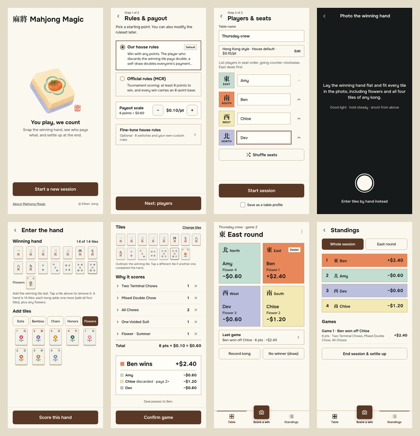
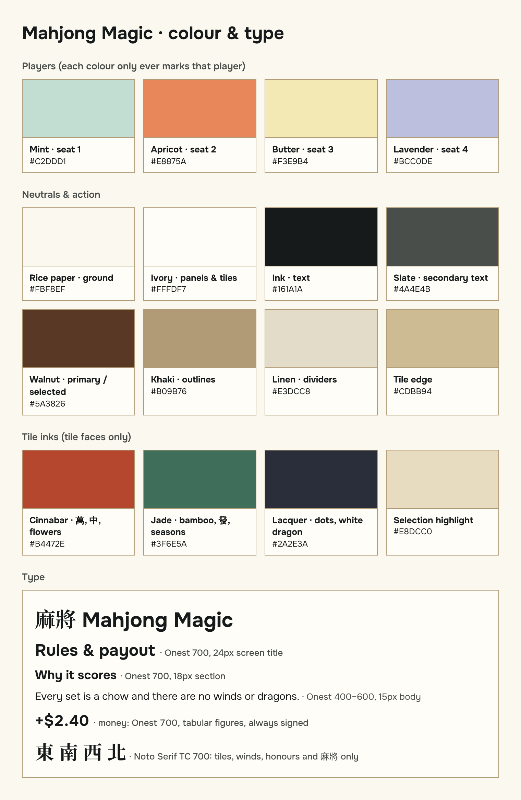
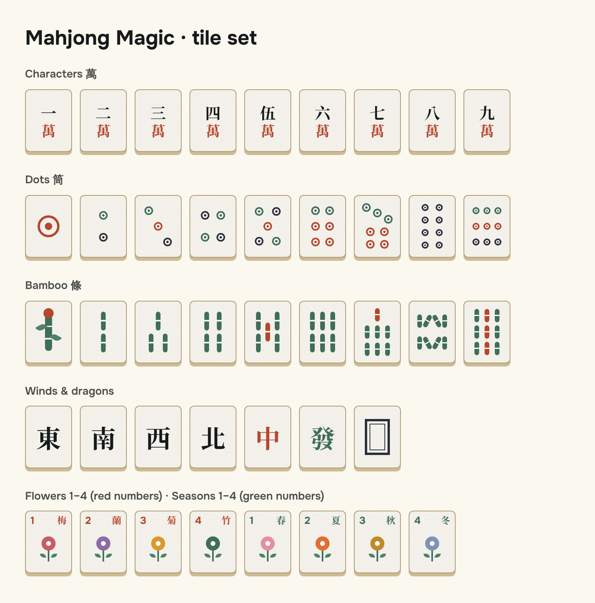

# Mahjong Magic: design

Companion to [`docs/PRD.md`](docs/PRD.md) (what we build) and [`docs/SPEC.md`](docs/SPEC.md) (how it's built). The tokens above match `src/styles.css`, which is the source of truth in code. The design canvas holds every screen: <https://claude.ai/artifact/NEDBQcLeHcyEun6cFHrFmp>.

## Overview

**Feel:** a well-loved paper score sheet next to a real tile set. Warm rice-paper ground, ink-black type, khaki outlines, one walnut brown for every action. Genuinely Chinese without tourist clichés: the Chinese characters are the ones printed on real tiles, never decoration.

**Mode:** an *operate* surface. It's used at a noisy table, often passed hand to hand, so clarity beats expression. One primary action per screen, in the thumb zone; money and seat info readable at arm's length.

**Brand assets**
| Asset | Use | File |
|---|---|---|
| Wordmark | 麻將 in Noto Serif TC + "Mahjong Magic" in Onest 700, side by side on one baseline | text, no image |
| Persimmon tile | The illustration on the first-time Home screen and the app icon. Lavender base, mint ruyi cloud around a persimmon, Eileen's seal bottom-right | `public/tile-art.png`, `public/icon-*.png` |
| Eileen's seal (印章) | Sign-off after "Magic." on the About page only, tilted 7°, 25px wide | `public/seal.png` |
| Portrait | About page, 96px square, khaki 1px border | `public/eileen.jpg` |

**Voice:** short, warm, plain English. Say what happens ("Paid now, even if they don't win the game"), name people, avoid jargon unless it's the real term players use (pung, kong, chow). Money is never vague: every amount is signed and in dollars.

## Colors

- **Ground `#FBF8EF` + ink `#161A1A`.** All text is ink or slate on light surfaces; no grey-on-colour, no white text except on walnut.
- **Walnut `#5A3826` is the only action colour:** primary buttons, selected segments, the selected-chip ring, the active tab, the "You" tag. Nothing else is brown.
- **Player colours belong to people, not to meaning.** Mint, apricot, butter and lavender always mark the same player in that session (their seat card, chips, standings row, payout swatch) and are never used for anything else: not success, not warnings, not decoration.
- **Neutral surfaces** (cards, notes, banners) use ivory `#FFFDF7` with a khaki `#B09B76` 1px outline. Dividers inside lists are linen `#E3DCC8`.
- **Tile inks** (cinnabar, jade, lacquer) appear only on tile faces, and in the 萬 / 中 / 發 glyphs.
- **Contrast:** body text is ink on ground (about 17:1). Slate `#4A4E4B` is for secondary text only, at 13px and up. Player colours are backgrounds behind ink text, never text colours.

## Typography

- **Onest** for all English and numbers (400 body, 500 captions, 600 labels, 700 titles and money).
- **Noto Serif TC 700** only for what appears on real tiles: tile faces, wind characters 東南西北, honours, and the 麻將 wordmark. No other Chinese in the UI.
- **Scale:** 30 wordmark · 24–28 screen title · 18 section · 15–16 body · 13 caption · 11–12 tags. Money uses tabular figures and is always signed (+$2.40 / −$1.20, with a real minus sign).
- **No italics anywhere.** Emphasis is weight, not slant.
- Body line height 1.45; long reading text (About) 1.6.

## Layout

- **Phone first, portrait.** Content max width 480px, centered on larger screens. 20px side gutter (24px on About).
- **Structure per screen:** header (← back + title, optional kicker like "Step 1 of 2") → scrolling body → sticky footer holding the single primary action.
- **During a session:** a bottom tab bar with Table · **Score a win** (the raised walnut camera button) · Standings. Everything else lives in the ⋯ menu.
- **Back always returns to the previous screen** (browser history), never a fixed screen.
- **Tap targets ≥ 44px**, no horizontal scroll at 360px. Respect the safe areas (`env(safe-area-inset-*)`).
- **Seat grid** on the Table follows the real table: East and South on top, North and West below.

## Elevation & Depth

Flat by default. Depth is used for exactly three things:
1. **Tiles** have a solid 4px "back edge" (`box-shadow: 0 4px 0 #CDBB94`) and a fine paper grain, like a real tile seen from above.
2. **The Score a win button** floats above the tab bar (`0 6px 14px rgba(90,56,38,0.25)`).
3. **Sheets** slide up over a 50% ink scrim (`rgba(22,26,26,0.5)`) with a khaki top border.

Selected player chips get a walnut ring with a ground-coloured gap (`0 0 0 2px #FBF8EF, 0 0 0 3px #5A3826`) instead of a shadow.

## Shapes

- **Containers are square** (0 radius): seat cards, panels, standings rows, banners, sheets.
- **Buttons, segments, chips and switches** are 8px rounded.
- **Tiles** are 6px rounded, 3:4 (60×80 at full size), scaled with CSS `zoom` for strips (0.6–0.85).
- **Lines are 1px khaki.** A 2px walnut border marks the one selected option in a list of cards, or the winning tile.

## Components

**Tiles**

- Ivory face, khaki border, tile-edge back, paper grain. Drawn in code (`src/components/Tile.tsx`), so they're crisp at any size.
- **Characters:** the number in ink over a cinnabar 萬. Five is written 伍.
- **Dots:** ringed circles in jade, cinnabar and lacquer, laid out like a real set (1 is one large cinnabar ring).
- **Bamboo:** jade sticks with a node, cinnabar accents on 5, 7 and 9. 1 of bamboo is a single decorated stalk with leaves and a cinnabar bud (not a bird).
- **Honours:** 東南西北 in ink, 中 cinnabar, 發 jade, white dragon as a double lacquer frame.
- **Flowers / seasons:** number top-left and character top-right (cinnabar for flowers 梅蘭菊竹, jade for seasons 春夏秋冬), with a small bloom. Seat number = flower number.

**Buttons**
- Primary: walnut fill, ground text, 56px, full width in the footer. One per screen.
- Secondary: transparent, khaki outline, ink text, 46–50px.
- Text link: no border, 600 weight, 44px tall hit area.
- Disabled primary: outline only with slate text, and the label says what's missing ("Add 5 more tiles").

**Segments and choices**
- Two to five equal segments; the selected one is walnut-filled.
- Player chips use that player's colour as the fill; the selected one gets the walnut ring.
- Starting-point choices (Rules) are radio cards: walnut-ringed dot, 2px walnut border when selected, a small "Default" tag.

**Switches:** 52×32, 8px rounded, walnut when on, linen when off, with an ivory 24px knob.

**Seat card (Table):** the player's colour fills the card. Top line: wind character + English wind, Dealer tag. Bottom: name, flower number, signed balance in 22px bold.

**Tags:** 22px tall, square, 1px khaki, 11–12px 600. Variants: Dealer, You (walnut fill), House rule, Custom, Edited, Default.

**Sheets:** square top, khaki top border, title + X close at the top, closable by tapping the scrim, Escape, or the phone's back gesture.

**Score screen patterns:** each line is a disclosure (chevron rotates 90°) with the pattern name, points on the right and an × to remove it for this game. House rules show a "House rule" tag. The total line shows "N pts × $0.10 = $0.60".

**Camera:** the only dark screen (ink background, ground text), so the photo is the focus. A round 78px shutter; "Enter tiles by hand instead" always visible.

**Motion:** minimal. A 120ms chevron rotation, and a spinner while a photo is read (slowed under reduced-motion). No decorative animation.

## Do's and Don'ts

**Do**
- Keep one primary walnut action per screen, in the footer.
- Give every amount a sign and every player their colour.
- Show tiles as tiles (the Tile component), never as text codes.
- Write in short, plain sentences, and name the person ("Ben wins", "Chloe discarded").
- Use real tile vocabulary: chow, pung, kong, discard, self-draw, dealer.

**Don't**
- Don't use a player colour for anything except that player.
- Don't add Chinese characters as decoration, or use Noto Serif TC for English.
- Don't use italics, gradients on surfaces, decorative shadows or extra accent colours.
- Don't round containers, or put text on colour in anything but ink (or ground on walnut).
- Don't add a second primary button, or hide "Enter tiles by hand" anywhere a photo is involved.
